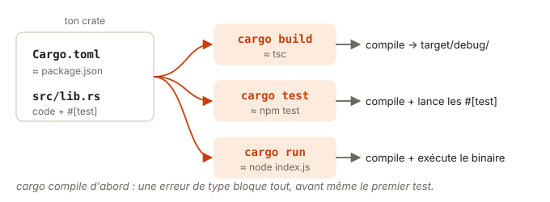

# 01 - Hello, cargo · cours

Comme dans tout bon début, tu vas commencer par un Hello World. Tu verras au passage que cargo fait à lui seul le travail de npm, tsc et vitest. Ensuite, tu écriras tes deux premières fonctions. Prévois un petit quart d'heure.

## Ce que tu vas apprendre

- Créer et lancer ton premier programme avec `cargo new` et `cargo run`.
- Lancer les tests d'un projet Rust avec cargo.
- Lire la signature d'une fonction Rust.
- Renvoyer une valeur sans écrire `return`.
- Construire une chaîne avec `format!`, l'équivalent des template strings.

## Ton premier programme

En TS, un Hello World tient en une ligne. Tu écris `console.log("Hello, world!")` dans un fichier, puis tu lances `node index.js`. En Rust, on passe par cargo dès le début. Dans un dossier à toi, en dehors de ce repo, tape :

```
cargo new hello
cd hello
cargo run
```

`cargo new` crée un projet complet :

```
hello/
├── Cargo.toml     ← l'équivalent du package.json
└── src/
    └── main.rs    ← le point d'entrée
```

Et `src/main.rs` contient déjà ton Hello World :

```rust
fn main() {
    println!("Hello, world!");
}
```

`cargo run` compile le programme, puis le lance :

```
   Compiling hello v0.1.0 (/…/hello)
    Finished `dev` profile [unoptimized + debuginfo] target(s) in 0.45s
     Running `target/debug/hello`
Hello, world!
```

Regarde trois choses. D'abord, `fn main()` est la fonction que Rust appelle au démarrage. Il n'y a pas de code qui s'exécute « au niveau du fichier » comme en JS. Ensuite, `println!` est ton `console.log` (on verra plus bas pourquoi il a un `!`). Enfin, cargo a produit un vrai exécutable, `target/debug/hello`, que tu peux lancer sans cargo ni runtime.

Les exercices de ce repo sont un peu différents. Ce sont des bibliothèques, dans `src/lib.rs`, sans `main`. On les fait tourner avec des tests, et c'est ce qu'on voit juste après.

## Cargo, c'est npm, tsc et vitest à la fois

En TS, tu jongles avec plusieurs outils. npm installe, tsc compile, vitest teste. En Rust, une seule commande fait tout ça, et c'est `cargo`.

| En TS | En Rust |
| --- | --- |
| `npm init` | `cargo new mon-projet` |
| `package.json` | `Cargo.toml` |
| `npm install zod` | `cargo add serde` |
| `npm run build` | `cargo build` |
| `npm test` | `cargo test` |
| `node index.js` | `cargo run` |

Un projet Rust s'appelle un **crate**. Ce repo en contient un par exercice. Celui-ci s'appelle `m01_e01_cargo`, et tu lances ses tests avec :

```
cargo test -p m01_e01_cargo
```

Le `-p` choisit le crate, comme `npm test -w` dans un monorepo.



## Les tests vivent à côté du code

En TS, tu mettrais tes tests dans un fichier à part, `greet.test.ts`. En Rust, ils sont souvent en bas du même fichier, dans un bloc spécial :

```rust
#[cfg(test)]
mod tests {
    use super::*;

    #[test]
    fn adds_two() {
        assert_eq!(add(2, 2), 4);
    }
}
```

`#[cfg(test)]` veut dire « ne compile ce bloc que pour les tests ». `assert_eq!` correspond à `expect(a).toBe(b)`.

Il y a une différence qui change tout. Rust compile **tout** le fichier avant de lancer le moindre test. Une seule erreur de type, même dans une fonction que personne ne teste, et rien ne tourne. C'est frustrant au début, puis tu t'y fais, parce que ce qui compile marche déjà bien plus souvent qu'en TS.

## Lire une fonction Rust quand on vient de TS

Voici la même fonction dans les deux langages :

```ts
function double(x: number): number {
  return x * 2;
}
```

```rust
fn double(x: i32) -> i32 {
    x * 2
}
```

Trois choses changent :

- `function` devient `fn`.
- Le type de retour vient après une flèche `->` et non après `:`.
- Les types des paramètres et du retour sont **obligatoires**. Rust ne devine jamais la signature d'une fonction.

Et il n'y a pas de `return`. C'est le point qui surprend le plus, alors regardons-le de près.

## La dernière ligne, sans point-virgule, est la valeur renvoyée

En Rust, presque tout est une **expression** : un bloc `{ ... }` a une valeur, et cette valeur, c'est sa dernière ligne si elle n'a **pas** de point-virgule.

Le point-virgule transforme une expression en instruction, qui ne vaut rien. Ajoute-le par réflexe de dev TS, et le compilateur te le dit tout de suite :

```
error[E0308]: mismatched types
 --> src/lib.rs:1:26
  |
1 | pub fn double(x: i32) -> i32 {
  |        ------            ^^^ expected `i32`, found `()`
  |        |
  |        implicitly returns `()` as its body has no tail or `return` expression
2 |     x * 2;
  |          - help: remove this semicolon to return this value
```

Prends le temps de lire ce message, c'est un bon exemple de ce que fait `rustc` :

- `E0308` est le code de l'erreur. `rustc --explain E0308` te l'explique en détail.
- La flèche `^^^` montre ce qui coince : la fonction promet un `i32`.
- `()` (prononcé « unit ») est le « rien » de Rust, l'équivalent de `void`.
- La ligne `help` te donne la piste.

`return` existe quand même. On le garde pour sortir tôt d'une fonction, comme une garde en TS.

## `String` et `&str`, juste ce qu'il faut pour l'instant

Rust a deux types de texte là où TS n'a que `string` :

- `String` est une chaîne que tu possèdes et que tu peux modifier. C'est ce que tu renvoies quand tu construis du texte.
- `&str` est une vue en lecture sur du texte qui appartient à quelqu'un d'autre. C'est ce que tu prends en paramètre quand tu veux juste lire.

Un littéral comme `"Bonjour"` est un `&str`. Pour en faire une `String`, écris `"Bonjour".to_string()` ou `String::from("Bonjour")`.

Pourquoi deux types ? C'est toute l'histoire de l'ownership, au module 02. Pour l'instant, retiens juste ceci : `&str` en entrée, `String` en sortie.

## `format!`, ta template string

En TS, tu construis du texte avec une template string :

```ts
const label = `${n} tâches restantes`;
```

En Rust, tu utilises la macro `format!`, qui renvoie une `String` :

```rust
let n = 3;
let label = format!("{n} tâches restantes");     // "3 tâches restantes"
let ratio = format!("{} sur {}", 2, n);          // "2 sur 3"
```

Le `!` signale une macro, c'est-à-dire du code qui en génère d'autre à la compilation. `println!` et `assert_eq!` en sont aussi. Pas besoin d'en savoir plus pour l'instant.

## Teste-toi

Avant de passer à la pratique, réponds de tête à ces quatre questions.

1. Cette fonction compile-t-elle ? `fn triple(x: i32) -> i32 { x * 3; }`
2. Que vaut `format!("{} + {}", 1, 2)` ?
3. Tu veux une fonction qui prend un nom et renvoie un message. Quel type pour le paramètre, quel type pour le retour ?
4. Dans ton projet `hello`, tu renommes `main` en `start`. Que dit `cargo run` ?

> **Réponses**
> 1. Non : le point-virgule fait renvoyer `()` au lieu d'un `i32`, c'est l'erreur E0308 vue plus haut.
> 2. La `String` `"1 + 2"`. `format!` ne calcule rien, il remplace chaque `{}` par la valeur suivante.
> 3. `&str` en entrée pour lire le nom, `String` en sortie parce que tu construis un nouveau texte.
> 4. Il refuse de compiler, avec l'erreur E0601 : « `main` function not found ». Un programme a besoin d'un `main` pour savoir par où commencer.

## À retenir

- `cargo new` crée un projet, `cargo run` le compile et le lance à partir de `fn main()`.
- `cargo test -p <crate>` compile puis lance les tests. Une erreur de type bloque tout.
- La dernière expression d'un bloc, sans point-virgule, est sa valeur.
- `&str` pour lire du texte, `String` pour en renvoyer un nouveau.
- `format!` construit une `String`, comme une template string.

## Pour aller plus loin

Tu as déjà tout ce qu'il faut pour l'exercice. Si tu as envie de creuser, voici quelques lectures, en anglais et complètement facultatives.

- [Rust Book 1.3 · Hello, Cargo!](https://rust-book.cs.brown.edu/ch01-03-hello-cargo.html) : avec son quiz.
- [Rust Book 3.3 · Functions](https://rust-book.cs.brown.edu/ch03-03-how-functions-work.html) : la partie « Functions with Return Values ».
- [std · format!](https://doc.rust-lang.org/std/macro.format.html) : toutes les options de formatage.
- [The Cargo Book](https://doc.rust-lang.org/cargo/) : la doc complète de cargo.
