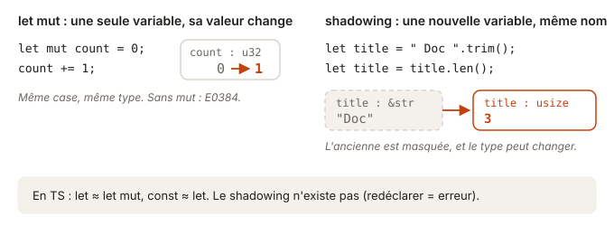

# 02 - Variables · cours

En TS, tu choisis entre `const` et `let`. Rust fait le même choix, mais dans l'autre sens : tout est constant par défaut, et c'est quand tu veux modifier une variable que tu dois le dire. Une dizaine de minutes de lecture suffit. Petit avertissement, l'exercice qui suit ne compile pas au départ, et c'est fait exprès.

## Ce que tu vas apprendre

- Déclarer une variable avec `let`, et la rendre modifiable avec `let mut`.
- Lire les erreurs E0384 et E0308.
- Utiliser le shadowing pour réutiliser un nom, même avec un autre type.

## `let`, c'est ton `const`

En Rust, une variable déclarée avec `let` ne peut plus changer. C'est le `const` que tu mets déjà partout en TS. Pour une variable qui bouge, tu ajoutes `mut` :

```ts
const done = 0;   // ne bougera plus
let todo = 3;     // va changer
todo -= 1;
```

```rust
let done = 0;       // ne bougera plus
let mut todo = 3;   // va changer
todo -= 1;
```

Pourquoi ce choix ? Quand tu lis du code Rust, chaque `mut` te signale un endroit où une valeur change. Tout le reste est fixe. Tu sais où regarder quand un bug apparaît.



## Quand tu oublies `mut`

Tu oublieras `mut`, c'est normal. Voici ce que le compilateur répond :

```rust
pub fn retries() -> u32 {
    let attempts = 0;
    attempts += 1;
    attempts
}
```

```
error[E0384]: cannot assign twice to immutable variable `attempts`
 --> src/lib.rs:3:5
  |
2 |     let attempts = 0;
  |         -------- first assignment to `attempts`
3 |     attempts += 1;
  |     ^^^^^^^^^^^^^ cannot assign twice to immutable variable
  |
help: consider making this binding mutable
  |
2 |     let mut attempts = 0;
  |         +++
```

Lis-le de haut en bas :

- La première ligne donne le code `E0384` et le problème en une phrase.
- Les `-----` pointent vers la cause, ici la déclaration.
- Les `^^^^^` pointent vers l'endroit où ça casse, ici l'affectation.
- Le bloc `help` propose une correction, avec des `+++` sous ce qu'il faut ajouter.

Ici, la proposition est la bonne. Ce ne sera pas toujours le cas, car le compilateur propose la correction la plus simple, pas forcément celle que tu voulais. Lis toujours la cause avant d'appliquer le `help`.

## Le shadowing : un nouveau `let` avec le même nom

Rust te laisse redéclarer une variable qui porte le même nom qu'une autre. La nouvelle « cache » l'ancienne, d'où le nom de shadowing :

```rust
let input = "  42  ";
let input = input.trim();        // toujours du texte : "42"
let input = input.len();         // maintenant un nombre : 2
```

Ce n'est pas une mutation. Chaque `let` crée une **nouvelle** variable, qui peut même changer de type. C'est pratique quand une valeur passe par plusieurs étapes de nettoyage. Tu gardes un seul nom au lieu d'inventer `rawInput`, `trimmedInput`, `inputLength`.

En TS, `const` interdit la redéclaration dans le même scope. Le shadowing n'a pas d'équivalent direct.

## Le type d'une variable ne change jamais tout seul

Avec le shadowing, tu peux annoncer le type de la nouvelle variable : `let input: usize = ...`. Mais attention, cette annotation ne **convertit** rien. Elle dit au compilateur ce que tu attends, et il vérifie :

```rust
let label = "prioritaire";
let label: usize = label;    // erreur E0308
```

```
error[E0308]: mismatched types
 --> src/lib.rs:3:24
  |
3 |     let label: usize = label;
  |                -----   ^^^^^ expected `usize`, found `&str`
  |                |
  |                expected due to this
```

Pour passer d'un texte à un nombre, il faut une opération qui produit ce nombre, comme `.len()` qui renvoie la longueur. En TS, `as number` fait taire le compilateur sans rien changer à la valeur. En Rust, une annotation ne fait jamais ça.

## Teste-toi

1. Ce code compile-t-il ? `let total = 10; total = total + 5;`
2. Et celui-ci ? `let total = 10; let total = total + 5;`
3. Après `let name = "Ada"; let name = name.len();`, quel est le type de `name` ?

> **Réponses**
> 1. Non, erreur E0384 : `total` n'est pas `mut`, on ne peut pas lui réaffecter une valeur.
> 2. Oui : le deuxième `let` crée une nouvelle variable `total` qui vaut 15. C'est du shadowing.
> 3. `usize`, le type que renvoie `.len()`. Le premier `name` (un `&str`) est caché, pas modifié.

## À retenir

- `let` est immuable par défaut : c'est ton `const`.
- `let mut` pour une variable qui change. Si tu l'oublies, c'est l'erreur E0384.
- Le shadowing crée une **nouvelle** variable avec le même nom, qui peut changer de type.
- Une annotation de type ne convertit jamais : elle vérifie.

## Pour aller plus loin

Tu as déjà tout ce qu'il faut pour l'exercice. Si tu as envie de creuser, voici quelques lectures, en anglais et complètement facultatives.

- [Rust Book 3.1 · Variables and Mutability](https://rust-book.cs.brown.edu/ch03-01-variables-and-mutability.html) : avec son quiz, shadowing compris.
- [Erreur E0384 · cannot assign twice to immutable variable](https://doc.rust-lang.org/error_codes/E0384.html)
- [Erreur E0308 · mismatched types](https://doc.rust-lang.org/error_codes/E0308.html)
