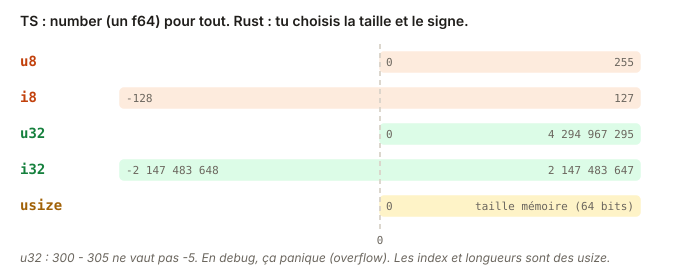

# 03 - Types numériques · cours

En TS, un nombre est un `number`, et c'est tout. Rust te demande de choisir : entier ou flottant, signé ou pas, sur combien de bits. Ça paraît lourd au début, mais c'est ce qui permet au compilateur d'attraper des bugs que JS laisse passer en silence. Compte un quart d'heure.

## Ce que tu vas apprendre

- Choisir le bon type numérique parmi `u32`, `i32`, `usize`, `f64` et les autres.
- Convertir d'un type à l'autre avec `as`, et savoir quand c'est risqué.
- Éviter l'overflow quand une soustraction peut passer sous zéro.
- Utiliser un tableau de taille fixe, `[u32; 3]`.

## Un number, plein de types

Le `number` de TS est toujours un flottant 64 bits. En Rust, tu as le choix :

| Famille | Types | Pour quoi |
| --- | --- | --- |
| Entiers non signés | `u8`, `u16`, `u32`, `u64`, `u128` | des quantités qui ne sont jamais négatives |
| Entiers signés | `i8`, `i16`, `i32`, `i64`, `i128` | des valeurs qui peuvent l'être |
| Taille mémoire | `usize`, `isize` | les index et les longueurs |
| Flottants | `f32`, `f64` | les nombres à virgule |

La lettre dit le signe (`u` pour unsigned, `i` pour integer), le nombre dit la taille en bits. Un `u8` va de 0 à 255, un `u32` jusqu'à environ 4 milliards.

Au quotidien, trois types suffisent : `u32` ou `i32` pour compter, `usize` pour ce qui touche aux index et aux `.len()`, `f64` pour les calculs à virgule.



## Rust ne convertit jamais à ta place

En JS, `1 + 1.5` marche, et `"3" * 2` aussi, hélas. En Rust, deux types différents ne se mélangent jamais sans que tu le demandes :

```rust
pub fn ratio(done: u32, total: u32) -> f64 {
    done / total
}
```

```
error[E0308]: mismatched types
 --> src/lib.rs:2:5
  |
1 | pub fn ratio(done: u32, total: u32) -> f64 {
  |                                        --- expected `f64` because of return type
2 |     done / total
  |     ^^^^^^^^^^^^ expected `f64`, found `u32`
```

La fonction promet un `f64`, mais `done / total` est un `u32`. Pour convertir, tu écris `as` :

```rust
let done: u32 = 7;
let as_float = done as f64;    // 7.0
```

Et une fois en `f64`, tous les opérandes doivent l'être aussi : `as_float / 2` ne compile pas, il faut écrire `as_float / 2.0`.

## La division entière tronque

Diviser deux entiers donne un entier. La partie après la virgule disparaît :

```rust
let a = 7 / 2;                  // 3, pas 3.5
let b = 7 as f64 / 2.0;         // 3.5
let c = (7 / 2) as f64;         // 3.0 : la division a eu lieu avant la conversion
```

Regarde bien la dernière ligne. Si tu veux un résultat à virgule, convertis **avant** de diviser.

## as peut tronquer sans prévenir

`as` ne vérifie rien. Il convertit, quitte à perdre de l'information :

```rust
let big: u32 = 300;
let small = big as u8;          // 44 : 300 ne tient pas dans un u8
let negative: i32 = -1;
let wrapped = negative as u32;  // 4294967295
```

Entre entiers et `f64`, dans le sens entier vers flottant, il n'y a pas de souci pour des valeurs courantes. Dans l'autre sens, ou vers un type plus petit, réfléchis à deux fois. Plus tard, tu verras `From` et `TryFrom`, des conversions qui refusent de perdre de l'information.

## Un u32 ne devient jamais négatif

Si une soustraction de `u32` devrait donner un nombre négatif, Rust ne te renvoie pas une valeur bizarre. En mode debug, le programme s'arrête net :

```
thread 'main' panicked at src/main.rs:4:20:
attempt to subtract with overflow
```

C'est un **panic** : l'équivalent d'une exception que personne n'attrape. Les tests tournent en mode debug, donc tu le verras là.

Pour soustraire sans risque, les entiers ont des méthodes dédiées :

```rust
let stock: u32 = 2;
let sold: u32 = 5;
stock.saturating_sub(sold)    // 0 : s'arrête à la borne au lieu de passer en dessous
stock.checked_sub(sold)       // None : « pas de résultat valide »
```

`checked_sub` renvoie une `Option`, que tu découvriras au module 03. Pour l'instant, retiens que les deux existent, et qu'il en va de même pour l'addition et la multiplication (`saturating_add`, `checked_mul`…).

## Les tableaux ont une taille fixe

Un tableau Rust s'écrit `[type; taille]`, et sa taille fait partie de son type :

```rust
let durations: [u32; 3] = [25, 40, 10];
let first = durations[0];     // 25
let len = durations.len();    // 3, un usize
```

Un `[u32; 3]` contient toujours exactement trois `u32`. Pas de `push`, pas de `pop`. C'est ce qui le distingue d'un tableau JS. La liste qui grandit, `Vec`, arrive au module suivant.

Tu peux parcourir un tableau avec `for`, comme dans l'exercice précédent :

```rust
for d in durations {
    // d vaut 25, puis 40, puis 10
}
```

## Teste-toi

1. Que vaut `9 / 4` en Rust ? Et `9 as f64 / 4.0` ?
2. `let n: u8 = 200; let m = n as i8;` compile-t-il ? Si oui, que vaut `m` ?
3. Tu as `let a: u32 = 3; let b: u32 = 8;`. Que se passe-t-il avec `a - b` dans un test ? Et avec `a.saturating_sub(b)` ?
4. Pourquoi `durations.len()` renvoie-t-il un `usize` et pas un `u32` ?

> **Réponses**
> 1. `2`, car la division entière tronque. Et `2.25` une fois converti en flottant avant de diviser.
> 2. Oui, `as` accepte toujours. `m` vaut `-56`, parce que 200 ne tient pas dans un `i8` (qui va de -128 à 127) et que `as` ne vérifie rien.
> 3. `a - b` fait paniquer le test avec « attempt to subtract with overflow ». `a.saturating_sub(b)` renvoie `0`.
> 4. Parce que `usize` est le type des tailles et des index en mémoire. Si tu veux combiner une longueur avec un `u32`, il faudra convertir l'un des deux.

## À retenir

- Pas de `number` unique : tu choisis le signe et la taille (`u32`, `i64`, `f64`…).
- Rust ne convertit jamais tout seul : `as` pour convertir, et il peut tronquer.
- Convertis en `f64` **avant** de diviser si tu veux des décimales.
- Un `u32` ne devient jamais négatif : en debug, l'overflow fait paniquer. `saturating_sub` et `checked_sub` l'évitent.
- `[T; N]` a une taille fixe, qui fait partie de son type.

## Pour aller plus loin

Tout ce qu'il faut pour l'exercice est au-dessus. Ces lectures sont facultatives et en anglais, pour creuser si tu en as envie.

- [Rust Book 3.2 · Data Types](https://rust-book.cs.brown.edu/ch03-02-data-types.html) : avec son quiz, surtout « Integer Overflow ».
- [std · u32](https://doc.rust-lang.org/std/primitive.u32.html) : toutes les méthodes des entiers, dont `saturating_sub` et `checked_sub`.
- [Rust Reference · type cast expressions (`as`)](https://doc.rust-lang.org/reference/expressions/operator-expr.html#type-cast-expressions) : les règles exactes de `as`.
