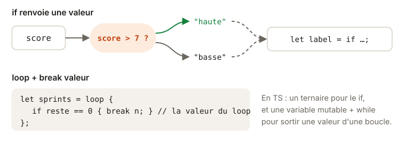

# 04 - Contrôle de flux · cours

`if`, `for`, `while`, tu connais tout ça par cœur en TS. La vraie différence, c'est qu'en Rust `if` et `loop` produisent une valeur, un peu comme le ternaire. Une fois que tu as pris le pli, ton code se débarrasse de pas mal de variables temporaires. Ça se lit en un quart d'heure.

## Ce que tu vas apprendre

- Utiliser `if` comme une expression qui renvoie une valeur.
- Parcourir un tableau ou une plage avec `for`.
- Sortir d'une `loop` avec `break` et une valeur.
- Écrire des plages : `0..5` et `0..=5`.

## if renvoie une valeur

En TS, quand tu veux choisir une valeur selon une condition, tu prends le ternaire :

```ts
const fee = isWeekend ? 5 : 3;
```

Rust n'a pas de ternaire, et il n'en a pas besoin : `if` est une expression, il fait déjà le travail.

```rust
let fee = if is_weekend { 5 } else { 3 };
```

Tu te souviens de la leçon sur cargo ? La dernière ligne d'un bloc, sans point-virgule, est sa valeur. Chaque branche de `if` est un bloc, donc chaque branche a une valeur.

Ça marche aussi avec plusieurs branches, et c'est bien plus lisible que des ternaires imbriqués :

```rust
let weather = if temp < 0 {
    "gel"
} else if temp < 20 {
    "frais"
} else {
    "chaud"
};
```

Remarque deux petits détails. Il n'y a pas de parenthèses autour de la condition, et les accolades sont obligatoires, même pour une seule ligne.



## Toutes les branches ont le même type

Puisque `if` produit une valeur, cette valeur a un type, et il doit être le même dans toutes les branches :

```rust
let s = if n > 1 { "plusieurs" } else { 1 };
```

```
error[E0308]: `if` and `else` have incompatible types
 --> src/lib.rs:2:45
  |
2 |     let s = if n > 1 { "plusieurs" } else { 1 };
  |                        -----------          ^ expected `&str`, found integer
  |                        |
  |                        expected because of this
```

Le compilateur prend le type de la première branche comme référence, puis te montre la branche qui ne suit pas. En TS, tu aurais eu un `string | number` sans t'en rendre compte.

## Un mot sur &'static str

Dans l'exercice, une fonction renvoie `&'static str`. Ça a l'air barbare, mais c'est simple. C'est le type d'un texte écrit en dur dans ton code, comme `"gel"`. Le `'static` dit que ce texte existe pendant toute la vie du programme. Tu peux donc le renvoyer sans souci. On reviendra sur ces apostrophes au module des lifetimes.

## for parcourt, les plages comptent

`for` parcourt tout ce qui se parcourt, comme `for...of` en TS :

```rust
let durations = [25, 40, 10];
let mut longest = 0;
for d in durations {
    if d > longest {
        longest = d;
    }
}
// longest vaut 40
```

Pour compter, tu utilises une plage :

- `0..5` va de 0 à 4. La borne de droite est exclue, comme dans `for (let i = 0; i < 5; i++)`.
- `0..=5` va de 0 à 5. Le `=` inclut la borne.

```rust
for day in 1..=7 {
    // day vaut 1, 2, ..., 7
}
```

Les plages servent aussi à tester un intervalle. `(1..=7).contains(&day)` vaut `true` si `day` est entre 1 et 7. Le `&` devant `day` sera expliqué au module 02, recopie-le tel quel pour l'instant.

`while` existe aussi et marche comme en TS. Et `continue` passe au tour suivant, comme en TS.

## loop et break avec une valeur

`loop` est une boucle infinie. Tu en sors avec `break`, et c'est là que Rust a une idée que TS n'a pas. `break` peut renvoyer une valeur, qui devient la valeur de toute la boucle.

```rust
let mut attempt = 0;
let found_at = loop {
    attempt += 1;
    if attempt * attempt > 50 {
        break attempt;    // la boucle vaut 8
    }
};
```

En TS, tu déclarerais une variable avant la boucle, tu l'affecterais dedans, puis tu ferais `break`. Ici, la boucle produit directement le résultat. C'est utile quand tu répètes une action jusqu'à ce qu'elle réussisse, comme une requête qu'on relance.

## Teste-toi

1. Que vaut `x` après `let x = if 3 > 5 { 10 } else { 20 };` ?
2. Combien de tours fait `for i in 2..6` ? Et `for i in 2..=6` ?
3. Ce code compile-t-il ? `let label = if ok { "oui" } else { "non"; };`
4. Que vaut `n` ici ? `let mut i = 1; let n = loop { i *= 2; if i > 20 { break i; } };`

> **Réponses**
> 1. `20`. Le `if` est une expression, il renvoie la valeur de la branche choisie.
> 2. 4 tours (2, 3, 4, 5) pour `2..6`, et 5 tours (2 à 6) pour `2..=6`.
> 3. Non. Le point-virgule après `"non"` fait valoir `()` à la branche `else`, alors que la branche `if` vaut un `&str` : erreur E0308.
> 4. `32`. `i` vaut 2, 4, 8, 16, puis 32, qui dépasse 20, et `break i` le renvoie.

## À retenir

- `if` est une expression : pas de ternaire en Rust, et toutes les branches ont le même type.
- `for x in ...` parcourt un tableau ou une plage.
- `0..n` exclut `n`, `0..=n` l'inclut.
- `loop` tourne jusqu'à un `break`, et `break valeur` donne sa valeur à la boucle.

## Pour aller plus loin

Tu as déjà tout ce qu'il faut pour l'exercice. Si tu as envie de creuser, voici quelques lectures, en anglais et complètement facultatives.

- [Rust Book 3.5 · Control Flow](https://rust-book.cs.brown.edu/ch03-05-control-flow.html) : avec son quiz.
- [Rust Reference · loop expressions](https://doc.rust-lang.org/reference/expressions/loop-expr.html) : les règles exactes des boucles et des labels.
