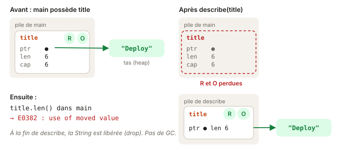

# 01 - Move · cours

Bienvenue dans le module le plus important du parcours. L'ownership, c'est la manière dont Rust gère la mémoire sans garbage collector, et tout le reste du langage s'appuie dessus. Ne te presse pas : cette leçon prend vingt minutes, et c'est normal de la relire.

## Ce que tu vas apprendre

- Pourquoi une valeur Rust a un seul propriétaire.
- Ce qu'est un move, et pourquoi l'ancien nom devient inutilisable.
- Lire l'erreur E0382 avec le modèle de permissions.
- Faire la différence entre les types qui se déplacent et ceux qui se copient.
- Quand un `.clone()` est justifié, et quand il cache un problème.

## En JS, tout le monde partage

En JS, quand tu passes un objet à une fonction, tu passes une référence. L'appelant et la fonction voient le même objet :

```ts
const tags = ["urgent"];
archive(tags);
tags.length;   // aucun souci, tags est toujours là
```

Qui libère la mémoire de `tags` ? Le garbage collector, plus tard, quand plus personne ne s'en sert. C'est confortable, mais ça a un coût : des pauses imprévisibles, de la mémoire qui traîne, et des bugs quand deux bouts de code modifient le même objet sans se prévenir.

## En Rust, une valeur a un seul propriétaire

Rust choisit une autre règle : chaque valeur a **un seul propriétaire**, la variable qui la détient. Quand ce propriétaire sort de son scope (la fin des accolades), la valeur est libérée immédiatement. Pas de GC, pas de pause.

```rust
{
    let title = String::from("Deploy");   // title possède la String
    // ... on utilise title
}   // fin du scope : la String est libérée ici, automatiquement
```

Cette libération s'appelle le **drop**. Tu n'as rien à écrire, le compilateur l'insère pour toi au bon endroit.

## Passer une valeur la déplace

Si une valeur n'a qu'un propriétaire, que se passe-t-il quand tu la passes à une fonction ? Elle change de propriétaire. On dit qu'elle est **déplacée** (moved) :

```rust
pub fn send(report: String) -> usize {
    report.len()
}

pub fn publish() {
    let report = String::from("Bilan Q3");
    send(report);           // la String part dans send
    println!("{report}");   // erreur : report ne possède plus rien
}
```

Après `send(report)`, c'est le paramètre de `send` qui possède la String. Et à la fin de `send`, elle est libérée. Si Rust te laissait lire `report` ensuite, tu lirais de la mémoire déjà rendue. C'est exactement le genre de bug que Rust interdit à la compilation.



## Lire l'erreur avec les permissions

La version du Rust Book que suit ce parcours explique l'ownership avec des **permissions**. Chaque variable a, à chaque ligne, un jeu de permissions sur sa donnée :

- **R** (read) : la lire.
- **W** (write) : la modifier.
- **O** (own) : la déplacer ou la libérer.

Reprenons `publish` ligne par ligne :

| Ligne | Ce qui se passe | Permissions de `report` |
| --- | --- | --- |
| `let report = String::from(...)` | `report` reçoit la String | R et O |
| `send(report)` | la String est déplacée | plus rien |
| `println!("{report}")` | il faudrait R | manquante : erreur |

(Pas de W ici, parce que `report` n'est pas `mut`.)

Voici ce que dit le compilateur :

```
error[E0382]: borrow of moved value: `report`
 --> src/lib.rs:8:16
  |
6 |     let report = String::from("Bilan Q3");
  |         ------ move occurs because `report` has type `String`, which does not implement the `Copy` trait
7 |     send(report);
  |          ------ value moved here
8 |     println!("{report}");
  |                ^^^^^^ value borrowed here after move
```

Les trois annotations racontent l'histoire : où la variable naît, où elle est déplacée, où tu essaies de t'en servir après. Quand tu vois E0382, cherche la ligne « value moved here ».

## Trois façons de s'en sortir

Le compilateur propose souvent `.clone()`. C'est rarement la meilleure réponse. Pose-toi d'abord la question : de quoi as-tu besoin, et à quel moment ?

1. **Changer l'ordre.** Si tu as besoin d'une info sur la valeur, prends-la avant de la déplacer.
2. **Emprunter au lieu de déplacer.** Si la fonction a juste besoin de lire, elle peut prendre une référence. C'est la leçon suivante.
3. **Copier, avec `.clone()`.** Quand tu as vraiment besoin de deux valeurs indépendantes, chacune avec son propriétaire.

Pour la première option, un exemple :

```rust
let report = String::from("Bilan Q3");
let words = report.split(' ').count();   // on lit d'abord
send(report);                             // puis on déplace
// words vaut 2, et on n'a plus besoin de report
```

## Les nombres se copient, les String se déplacent

Tu as peut-être remarqué qu'avec des nombres, aucun souci :

```rust
let count = 5;
let other = count;   // count est copié
println!("{count}"); // ok
```

Les types simples, dont la taille est petite et connue (`i32`, `u32`, `f64`, `bool`, `char`), implémentent le trait **`Copy`**. Ils sont copiés bit à bit, c'est gratuit, donc pas de move. Une `String`, elle, pointe vers du texte de taille variable stocké ailleurs en mémoire (sur le tas). La copier coûte quelque chose, donc Rust ne le fait jamais sans que tu le demandes.

C'est ce que dit la fin du message d'erreur : « `String`, which does not implement the `Copy` trait ».

## Quand clone est la bonne réponse

`.clone()` crée une copie complète et indépendante :

```rust
let original = String::from("brouillon");
let backup = original.clone();   // deux String, deux propriétaires
```

Il est légitime quand tu as besoin de **deux propriétaires**, par exemple pour stocker la même valeur à deux endroits qui vivront chacun leur vie. Il est suspect quand il sert juste à faire taire le compilateur alors qu'un réordonnancement ou un emprunt suffirait. Le tuteur te signalera ces `.clone()`-là.

## Un mot sur Vec

L'exercice utilise un `Vec<String>`, la liste qui grandit, l'équivalent d'un `string[]` en TS :

```rust
let mut queue = Vec::new();        // liste vide
queue.push(String::from("a"));     // la String est déplacée dans la liste
let ids = vec![1, 2, 3];           // vec! crée une liste directement
```

`push` prend possession de ce que tu lui donnes : après `queue.push(s)`, la variable `s` est déplacée dans la liste.

## Teste-toi

1. Après `let a = String::from("x"); let b = a;`, peut-on lire `a` ?
2. Après `let a = 42; let b = a;`, peut-on lire `a` ?
3. Une fonction reçoit une `String` par valeur. Qui libère cette String, et quand ?
4. Dans `list.push(name); println!("{name}");`, avec `name` une `String`, quelle erreur attends-tu, et sur quelle ligne pointe « value moved here » ?

> **Réponses**
> 1. Non. La String est déplacée dans `b`, `a` perd ses permissions R et O.
> 2. Oui. Un entier est `Copy` : `b` reçoit une copie, `a` garde tout.
> 3. La fonction, à la fin de son scope, sauf si elle la renvoie ou la déplace ailleurs.
> 4. E0382, « borrow of moved value ». « value moved here » pointe sur `list.push(name)`.

## À retenir

- Chaque valeur a **un seul propriétaire**. Quand il sort du scope, la valeur est libérée (drop).
- Passer une `String` par valeur la **déplace** : l'ancien nom perd ses permissions R et O.
- Les types simples (`i32`, `bool`…) sont `Copy` : ils sont copiés, pas déplacés.
- Face à E0382 : réordonne, emprunte, et ne clone que si tu as besoin de deux propriétaires.

## Pour aller plus loin

Tout ce qu'il faut pour l'exercice est au-dessus. Ces lectures sont facultatives et en anglais, pour creuser si tu en as envie.

- [Rust Book 4.1 · What is Ownership?](https://rust-book.cs.brown.edu/ch04-01-what-is-ownership.html) : avec ses quiz et les schémas de la pile et du tas.
- [Erreur E0382 · use of moved value](https://doc.rust-lang.org/error_codes/E0382.html)
