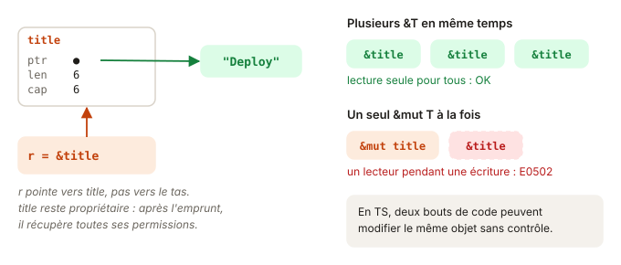

# 02 - Références et borrowing · cours

## À lire dans le Rust Book

- [Rust Book 4.2 · References and Borrowing](https://rust-book.cs.brown.edu/ch04-02-references-and-borrowing.html)
- [std · String::insert_str](https://doc.rust-lang.org/std/string/struct.String.html#method.insert_str)
- [std · mem::swap](https://doc.rust-lang.org/std/mem/fn.swap.html)

## L'idée



Pour utiliser une valeur sans en prendre possession, on l'**emprunte** :

- `&T` : référence partagée, lecture seule. Autant qu'on veut en même temps.
- `&mut T` : référence mutable. Une seule à la fois, et aucune `&T` pendant ce temps.

C'est la règle « plusieurs lecteurs **ou** un seul écrivain ». En TS, rien n'empêche deux bouts de code de modifier le même objet en même temps ; en Rust, c'est vérifié à la compilation.

```ts
function addPrefix(task: { title: string }) { task.title = "[urgent] " + task.title; }
```
```rust
fn add_prefix(title: &mut String) { /* ... */ }
add_prefix(&mut title); // l'appelant écrit explicitement &mut : la mutation se voit à l'appel
```

## À retenir

- `&T` emprunte en lecture ; `&mut T` emprunte en écriture.
- Plusieurs `&T` **ou** une seule `&mut T`, jamais les deux en même temps.
- Pendant un emprunt, le propriétaire perd temporairement des permissions ; il les récupère quand l'emprunt n'est plus utilisé.
