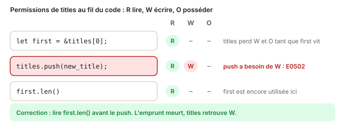

# 03 - Corriger les erreurs d'ownership · cours

Maintenant que tu connais les moves et les emprunts, on passe à ce que tu vas vivre tous les jours. Cette leçon prend trois erreurs que tu croiseras sans arrêt, et montre comment les corriger **bien**. Pour chacune, il existe une correction qui compile mais qui cache le problème, et une autre qui le règle vraiment. Compte une vingtaine de minutes.

## Ce que tu vas apprendre

- Une méthode en trois questions pour lire n'importe quelle erreur d'ownership.
- Corriger E0106 : renvoyer une référence vers une valeur locale.
- Corriger E0502 : modifier une valeur pendant qu'on la lit.
- Corriger E0507 : sortir une valeur d'une collection empruntée.
- Repérer les mauvaises corrections : `.clone()` réflexe et `'static` plaqué.

## La méthode : trois questions

Face à une erreur d'ownership, ne saute pas sur le `help` du compilateur. Pose-toi plutôt ces trois questions :

1. **Quelle permission manque ?** Lire (R), écrire (W) ou posséder (O).
2. **Sur quel chemin ?** La variable, ou un morceau d'elle, comme `list[0]`.
3. **Depuis quelle ligne ?** Où l'a-t-elle perdue : un move, un emprunt encore actif, une sortie de scope ?

Ensuite seulement, demande-toi ce que le programme **essaie de faire**. La bonne correction découle de l'intention, pas de l'erreur.



## E0106 : une référence vers rien

```rust
pub fn make_tag() -> &String {
    let tag = String::from("#rust");
    &tag
}
```

```
error[E0106]: missing lifetime specifier
 --> src/lib.rs:1:22
  |
1 | pub fn make_tag() -> &String {
  |                      ^ expected named lifetime parameter
  |
  = help: this function's return type contains a borrowed value, but there is no value for it to be borrowed from
```

Applique la méthode. `tag` appartient à la fonction. À la fin de la fonction, `tag` sort du scope et la `String` est libérée. La référence renvoyée pointerait vers une donnée qui n'existe plus. En JS, ce problème n'existe pas, parce que le GC garde l'objet en vie tant que quelqu'un le référence. En Rust, c'est le propriétaire qui décide quand la donnée meurt.

Le message `help` propose deux pistes :

- `&'static String` : c'est la mauvaise. `'static` veut dire « vit pendant tout le programme », ce qui est faux pour une `String` créée dans la fonction. Ça ne compilera pas mieux.
- Renvoyer `String` au lieu de `&String` : c'est la bonne. La fonction crée la valeur, elle la **donne** à l'appelant, qui en devient propriétaire.

Retiens-le comme ça : une fonction qui fabrique une valeur la renvoie par valeur.

## E0502 : lire et écrire en même temps

```rust
pub fn grow(scores: &mut Vec<u32>) -> u32 {
    let best = &scores[0];
    scores.push(10);
    *best
}
```

```
error[E0502]: cannot borrow `*scores` as mutable because it is also borrowed as immutable
 --> src/lib.rs:3:5
  |
2 |     let best = &scores[0];
  |                 ------ immutable borrow occurs here
3 |     scores.push(10);
  |     ^^^^^^^^^^^^^^^ mutable borrow occurs here
4 |     *best
  |     ----- immutable borrow later used here
```

Raisonne avec les permissions. `push` a besoin de W sur `scores`. Mais à la ligne 2, `best` emprunte en lecture un élément de la liste, et cet emprunt est encore utilisé à la ligne 4. Pendant ce temps, `scores` n'a que R.

Ce n'est pas du zèle. Un `Vec` range ses éléments dans un bloc de mémoire. Quand tu fais `push` et que le bloc est plein, le `Vec` en alloue un plus grand ailleurs et y déménage tout. `best` pointerait alors vers l'ancien emplacement, libéré. En C++, c'est un crash classique. En JS, le GC te protège, mais tu peux quand même lire un état périmé.

Pour bien corriger, fais en sorte que l'emprunt soit terminé avant la modification. Demande-toi ce dont tu as vraiment besoin après le `push`. Si c'est une petite valeur `Copy`, comme un nombre, tu peux la calculer avant et garder ce nombre plutôt qu'une référence.

## E0507 : sortir une valeur d'une collection empruntée

```rust
pub fn next_in_queue(queue: &Vec<String>) -> usize {
    let next = queue[0];
    next.len()
}
```

```
error[E0507]: cannot move out of index of `Vec<String>`
 --> src/lib.rs:2:16
  |
2 |     let next = queue[0];
  |                ^^^^^^^^ move occurs because value has type `String`, which does not implement the `Copy` trait
```

En JS, `const next = queue[0]` copie une référence, sans conséquence. En Rust, `let next = queue[0]` essaie de **déplacer** la `String` hors de la liste. Ça pose deux problèmes. La fonction n'a qu'un emprunt de `queue` (pas de permission O), et une liste avec un trou au milieu n'aurait pas de sens.

Le compilateur propose deux corrections :

- `queue[0].clone()` : ça compile, mais copie toute la `String` juste pour la lire. C'est la mauvaise ici.
- `&queue[0]` : emprunte l'élément au lieu de le déplacer. C'est la bonne, puisqu'on veut seulement le lire.

Avec un `Vec<u32>`, `queue[0]` aurait marché directement, parce qu'un `u32` est `Copy`. C'est pour les types qui ne sont pas `Copy`, comme `String`, que la question se pose.

## Le `.clone()` réflexe

Dans les trois cas, `.clone()` aurait pu faire taire le compilateur. C'est tentant, et c'est la correction qu'un agent IA propose le plus souvent. Mais un clone copie la donnée, et cache la vraie question, celle de savoir qui possède quoi, et pour combien de temps.

Avant d'écrire `.clone()`, demande-toi si tu as vraiment besoin de **deux valeurs indépendantes**. Si la réponse est « non, je veux juste lire », il te faut un emprunt.

## Teste-toi

1. Une fonction crée un `Vec<String>` et veut le renvoyer. Elle renvoie `&Vec<String>` et ne compile pas. Quelle correction ?
2. Dans `let first = &list[0]; list.clear(); println!("{first}");`, quelle permission manque à `list.clear()`, et pourquoi ?
3. Avec `names: &Vec<String>`, pourquoi `let n = names[0];` ne compile pas alors que `let n = ids[0];` compile avec `ids: &Vec<u32>` ?

> **Réponses**
> 1. Renvoyer `Vec<String>` par valeur : la fonction fabrique la liste et la donne à l'appelant.
> 2. W sur `list`. `first` emprunte encore un élément en lecture, puisqu'il est utilisé après `clear`. Il faut terminer cet usage avant de vider la liste.
> 3. `String` n'est pas `Copy`, donc `names[0]` tenterait un move hors d'un emprunt (E0507). `u32` est `Copy`, donc `ids[0]` est une simple copie.

## À retenir

- Lis une erreur d'ownership avec trois questions : quelle permission, sur quel chemin, depuis quelle ligne.
- Ne renvoie pas de référence vers une valeur locale : renvoie la valeur elle-même.
- Termine un emprunt en lecture avant de modifier la valeur empruntée.
- Pour lire un élément d'une collection empruntée, emprunte-le (`&list[i]`), ne le déplace pas.
- `.clone()` fait taire le compilateur mais copie la donnée : il faut une vraie raison de copier.

## Pour aller plus loin

Tu as déjà tout ce qu'il faut pour l'exercice. Si tu as envie de creuser, voici quelques lectures, en anglais et complètement facultatives.

- [Rust Book 4.3 · Fixing Ownership Errors](https://rust-book.cs.brown.edu/ch04-03-fixing-ownership-errors.html) : le chapitre que la version Brown a ajouté, avec beaucoup d'autres cas.
- [Erreur E0106 · missing lifetime specifier](https://doc.rust-lang.org/error_codes/E0106.html)
- [Erreur E0502 · cannot borrow as mutable because it is also borrowed as immutable](https://doc.rust-lang.org/error_codes/E0502.html)
- [Erreur E0507 · cannot move out of borrowed content](https://doc.rust-lang.org/error_codes/E0507.html)
