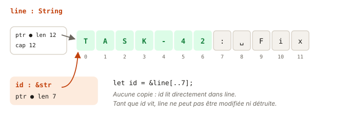

# 04 - Slices · cours

En TS, `line.slice(0, 7)` crée une nouvelle chaîne. Rust a une meilleure idée : regarder une partie du texte **sans le copier**. C'est la slice, une référence vers un morceau de donnée. Tu vas t'en servir partout, notamment pour parser des requêtes dans tes backends. Compte vingt minutes.

## Ce que tu vas apprendre

- Ce qu'est une slice, `&str` pour le texte et `&[T]` pour les listes.
- Pourquoi une fonction qui lit du texte prend `&str` plutôt que `&String`.
- Découper du texte avec les méthodes de `str`, sans rien copier.
- Gérer le cas « pas trouvé » avec `Option`, en version courte.
- Éviter le piège des caractères accentués.

## Une vue, pas une copie

Une slice, c'est une référence vers une partie d'une donnée. Elle contient juste deux choses : où commence le morceau, et sa longueur.

```ts
const url = "api.taskr.dev/projects";
const host = url.slice(0, 13);   // nouvelle chaîne, copiée
```

```rust
let url = String::from("api.taskr.dev/projects");
let host = &url[0..13];    // "api.taskr.dev", une vue sur url
let path = &url[14..];     // "projects", jusqu'à la fin
```

Aucune mémoire n'est allouée pour `host` ou `path`. Elles pointent dans `url`. Sur un serveur qui découpe des milliers de requêtes par seconde, cette différence compte.

Les plages marchent comme dans la leçon sur le contrôle de flux : `[0..13]` exclut 13, `[14..]` va jusqu'au bout, `[..5]` part du début.



## Une slice est un emprunt

Une slice est une référence, donc les règles de la leçon sur le borrowing s'appliquent. Tant que `host` est utilisée, `url` perd sa permission W :

```rust
let mut url = String::from("api.taskr.dev/projects");
let host = &url[0..13];
url.clear();             // erreur E0502 : host lit encore url
println!("{host}");
```

C'est ce qui rend la vue sûre. En C, tu pourrais vider la chaîne et garder un pointeur vers du vide. Ici, le compilateur refuse.

## &str partout pour lire du texte

Tu as déjà croisé `&str` dans les leçons précédentes. En fait, c'est une slice de texte. Un littéral `"Deploy"` est un `&str` qui pointe dans le binaire du programme, et `&ma_string[..]` est un `&str` qui pointe dans une `String`.

D'où la règle : une fonction qui lit du texte prend `&str`. Elle accepte alors les deux :

```rust
pub fn is_urgent(title: &str) -> bool {
    title.starts_with("[urgent]")
}

is_urgent("[urgent] Deploy");               // un littéral
let t = String::from("Relire");
is_urgent(&t);                              // une String, prêtée
```

Avec `&String` en paramètre, le premier appel ne compilerait pas. Rust convertit automatiquement `&String` en `&str`, mais pas l'inverse.

Et une fonction peut **renvoyer** une slice de son paramètre : `fn host(url: &str) -> &str`. Le résultat pointe dans le texte reçu, sans copie. Le compilateur comprend que le résultat emprunte le paramètre.

## Les méthodes de str

Le type `str` a beaucoup de méthodes qui renvoient des slices, sans rien copier. Les plus utiles :

| Méthode | Exemple | Résultat |
| --- | --- | --- |
| `trim()` | `"  x y ".trim()` | `"x y"` |
| `split_whitespace()` | `"  un  deux ".split_whitespace()` | `"un"`, puis `"deux"` |
| `find(c)` | `"a,b".find(',')` | `Some(1)` |
| `split_once(c)` | `"clé=valeur".split_once('=')` | `Some(("clé", "valeur"))` |
| `starts_with(s)` | `"[urgent] x".starts_with("[urgent]")` | `true` |

`split_whitespace()` renvoie un **itérateur** : tu peux le parcourir avec `for`, ou lui demander son premier élément avec `.next()`. Les itérateurs auront leur module plus tard.

Tu as remarqué les `Some(...)` ? C'est le sujet de la section suivante.

## Option, en version courte

Que doit renvoyer `find` quand le caractère n'est pas là ? En JS, `indexOf` renvoie `-1`, et tout le monde a déjà oublié de le tester. Rust renvoie une `Option` : soit `Some(valeur)`, soit `None`.

```rust
"clé=valeur".split_once('=')   // Some(("clé", "valeur"))
"clé".split_once('=')          // None
```

Tu ne peux pas utiliser la valeur sans traiter le cas `None`. La façon la plus claire, c'est `match`, qui liste les cas :

```rust
let tags = "rust,web,api";
let comma_at = match tags.find(',') {
    Some(i) => i,     // trouvé : i vaut 4
    None => tags.len(),
};
```

`match` est une expression, comme `if` : chaque branche donne une valeur, du même type. `Some(i)` récupère ce qu'il y a dans la boîte et l'appelle `i`. Quand l'`Option` contient un tuple, comme avec `split_once`, tu écris `Some((a, b))`, et `_` pour une partie dont tu ne te sers pas. `Option` et `match` ont un module entier plus tard. Pour l'instant, ce motif suffit.

## Les slices de listes : &[T]

Le même principe marche pour les tableaux et les `Vec`. Une `&[T]` est une vue sur une suite d'éléments :

```rust
let scores = vec![3, 8, 1, 9];
let middle = &scores[1..3];     // [8, 1]
let all: &[u32] = &scores;      // tout le Vec, vu comme une slice
```

Comme pour le texte, une fonction qui lit une liste prend `&[T]`. Elle accepte alors un `Vec`, un tableau, ou un morceau de l'un d'eux. Et tu peux la parcourir avec `for x in slice`.

## Le piège des accents

Les index d'une `&str` comptent en **octets**, pas en caractères. Or Rust stocke le texte en UTF-8, où `É` prend deux octets :

```rust
"Écrire".len()            // 7, pas 6
let first = &"Écrire"[0..1];
```

```
thread 'main' panicked at src/main.rs:2:22:
end byte index 1 is not a char boundary; it is inside 'É' (bytes 0..2 of string)
```

Le programme panique, parce que couper au milieu d'un caractère produirait du texte invalide. La parade : n'écris pas d'index à la main sur du texte. Utilise les positions que te donnent `find` ou `split_once`, ou les méthodes comme `split_whitespace`. Elles coupent toujours au bon endroit.

## Teste-toi

1. Une fonction `fn shout(s: &String)` est appelée avec `shout("hey")`. Ça compile ? Que changerais-tu ?
2. Que renvoie `"a:b:c".split_once(':')` ?
3. Ce code compile-t-il ? `let mut s = String::from("hello"); let h = &s[..2]; s.push('!'); println!("{h}");`
4. Une fonction prend `&[u32]`. Peut-on lui passer `&v[2..]` avec `v` un `Vec<u32>` ? Et `&[1, 2]` ?

> **Réponses**
> 1. Non : `"hey"` est un `&str`, pas un `&String`. Il faut que la fonction prenne `&str`, et elle acceptera les deux.
> 2. `Some(("a", "b:c"))` : la coupe se fait au premier `:` seulement.
> 3. Non, erreur E0502 : `h` emprunte `s` et sert encore après le `push`.
> 4. Oui dans les deux cas : une slice de Vec et un tableau emprunté sont tous deux des `&[u32]`.

## À retenir

- `&str` et `&[T]` sont des vues (un début et une longueur), sans copie.
- Une slice est un emprunt : la donnée d'origine ne peut pas changer tant que la slice sert.
- Pour lire du texte, prends `&str` : tu acceptes ainsi les `&String` et les littéraux.
- `Option` remplace le `-1` ou le `null` : `Some(valeur)` ou `None`, à traiter avec `match`.
- Les index de texte sont des octets : laisse `find`, `split_once` et compagnie couper pour toi.

## Pour aller plus loin

Tout ce qu'il faut pour l'exercice est au-dessus. Ces lectures sont facultatives et en anglais, pour creuser si tu en as envie.

- [Rust Book 4.4 · The Slice Type](https://rust-book.cs.brown.edu/ch04-04-slices.html) : avec ses quiz.
- [std · str](https://doc.rust-lang.org/std/primitive.str.html) : toutes les méthodes de texte.
- [std · slice](https://doc.rust-lang.org/std/primitive.slice.html) : toutes les méthodes des slices de listes.
