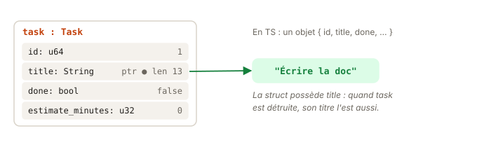

# 05 - Structs · cours

## À lire dans le Rust Book

- [Rust Book 5.1 · Defining and Instantiating Structs](https://rust-book.cs.brown.edu/ch05-01-defining-structs.html)
- [Rust Book 5.2 · An Example Program Using Structs](https://rust-book.cs.brown.edu/ch05-02-example-structs.html) : `#[derive(Debug)]`

## L'idée



Une `struct` Rust, c'est une `interface` TS **et** la donnée en même temps. Il n'y a pas d'objet littéral anonyme : on nomme toujours le type.

```ts
interface Task { id: number; title: string; done: boolean }
const t: Task = { id: 1, title: "Écrire la doc", done: false };
const t2 = { ...t, id: 2 };
```
```rust
struct Task { id: u64, title: String, done: bool }
let t = Task { id: 1, title: String::from("Écrire la doc"), done: false };
let t2 = Task { id: 2, ..t };
```

Deux choses à remarquer :
- Le champ `title` est une `String` et pas une `&str` : la struct **possède** son titre. Avec une `&str`, il faudrait une lifetime (chapitre 10). Pour passer d'une `&str` à une `String` : `String::from(...)` ou `.to_string()`.
- `#[derive(Debug, PartialEq)]` génère l'affichage debug et la comparaison `==`. C'est ce qui permet `assert_eq!` sur une struct.

## À retenir

- Une `struct` nomme toujours son type : pas d'objet littéral anonyme.
- Une struct qui possède ses champs (`String`) les détruit avec elle.
- `#[derive(Debug, PartialEq)]` génère l'affichage debug et `==`.
