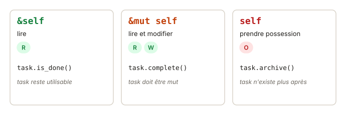

# 06 - Méthodes · cours

Tes structs ont des données, mais pas encore de comportement. En TS, tu écrirais une `class`. Rust n'a pas de classes, il range la donnée dans la `struct` et le comportement dans un bloc `impl`. Et grâce à tout ce que tu sais déjà sur l'ownership, la signature de chaque méthode te dira exactement ce qu'elle fait de l'objet. Ça se lit en un quart d'heure.

## Ce que tu vas apprendre

- Ajouter des méthodes à une struct avec `impl`.
- Choisir entre `&self`, `&mut self` et `self`.
- Écrire une fonction associée, comme le constructeur `new`.
- Construire un affichage lisible avec `format!`.

## Pas de class : une struct et un impl

Voici un petit compteur, en TS puis en Rust :

```ts
class Counter {
  value = 0;
  constructor(public label: string) {}
  get() { return this.value; }
  bump() { this.value += 1; }
}
const c = new Counter("visites");
c.bump();
```

```rust
pub struct Counter {
    label: String,
    value: u32,
}

impl Counter {
    pub fn new(label: &str) -> Self {
        Counter { label: label.to_string(), value: 0 }
    }

    pub fn get(&self) -> u32 {
        self.value
    }

    pub fn bump(&mut self) {
        self.value += 1;
    }
}

let mut c = Counter::new("visites");
c.bump();
```

La struct déclare les champs, le bloc `impl Counter` regroupe les fonctions qui vont avec. `this` devient `self`, et il est écrit explicitement en premier paramètre. `Self`, avec une majuscule, est un raccourci pour le nom du type, ici `Counter`.



## Le premier paramètre dit tout

C'est la partie la plus importante. Le premier paramètre d'une méthode, c'est le contrat entre la méthode et l'appelant :

| Signature | La méthode peut… | Équivaut à | Exemple |
| --- | --- | --- | --- |
| `&self` | lire | `&Counter` | `get`, un affichage |
| `&mut self` | lire et modifier | `&mut Counter` | `bump`, un setter |
| `self` | prendre possession | `Counter` | transformer l'objet en autre chose |

Ce sont exactement les emprunts et les moves des leçons précédentes, appliqués à l'objet sur lequel tu appelles la méthode. En TS, n'importe quelle méthode peut modifier `this` sans que l'appelant le sache. En Rust, la signature le dit, et le compilateur le vérifie.

Choisis toujours le minimum. `&self` si lire suffit, `&mut self` si tu modifies, `self` seulement si l'objet ne doit plus servir après.

## Quand l'objet n'est pas mut

Appeler une méthode `&mut self` demande une permission W. Si la variable n'est pas `mut` :

```rust
let c = Counter::new("visites");
c.bump();
```

```
error[E0596]: cannot borrow `c` as mutable, as it is not declared as mutable
  --> src/main.rs:2:5
   |
2  |     c.bump();
   |     ^ cannot borrow as mutable
```

Rust prête l'objet en `&mut` à la méthode sans que tu l'écrives, mais il lui faut quand même le droit de le faire. Il suffit d'écrire `let mut c`.

## self tout court : la méthode consomme l'objet

Une méthode qui prend `self` par valeur reçoit l'objet, comme une fonction qui reçoit une `String`. Après l'appel, l'objet est déplacé :

```rust
impl Counter {
    pub fn into_label(self) -> String {
        self.label
    }
}

let c = Counter::new("visites");
let label = c.into_label();
println!("{}", c.get());   // erreur E0382 : c a été déplacé dans into_label
```

Le compilateur l'explique dans sa note, « `Counter::into_label` takes ownership of the receiver `self`, which moves `c` ». C'est utile quand l'objet se transforme en autre chose et n'a plus de raison d'exister. Par convention, ces méthodes commencent souvent par `into_`.

## new n'a rien de magique

Rust n'a pas de mot-clé `constructor`. `new` est une **fonction associée**. Elle est dans le bloc `impl`, mais ne prend pas de `self`. On l'appelle avec `::`, sur le type :

```rust
let c = Counter::new("visites");   // comme une méthode static en TS
```

Le nom `new` est juste une convention, que tout le monde suit. Tu peux en écrire d'autres, comme `Counter::starting_at(label, 10)`.

## Construire un affichage lisible

Pour produire un texte à partir des champs, tu combines `format!` (vu dans la leçon sur cargo) et `if` comme expression (vu dans la leçon sur le contrôle de flux) :

```rust
impl Counter {
    pub fn badge(&self) -> String {
        let icon = if self.value > 100 { "🔥" } else { "·" };
        format!("{icon} {} : {}", self.label, self.value)
    }
}
// Counter "visites" à 120 : "🔥 visites : 120"
```

Et pour tester un texte « vide ou fait seulement d'espaces », `str` a ce qu'il faut. `trim()` enlève les espaces autour, `is_empty()` dit si le résultat est vide.

## Teste-toi

1. Une méthode `fn reset(&mut self)` est appelée sur `let c = Counter::new("x");`. Quelle erreur ?
2. Quelle signature pour une méthode `is_zero` qui renvoie `true` si le compteur vaut 0 ?
3. Après `let name = user.into_name();`, peut-on encore appeler `user.email()` ?
4. Comment appelles-tu une fonction associée `Counter::starting_at` ? Et une méthode `get` ?

> **Réponses**
> 1. E0596 : `c` n'est pas `mut`, donc on ne peut pas l'emprunter en écriture.
> 2. `pub fn is_zero(&self) -> bool` : elle ne fait que lire.
> 3. Non, si `into_name` prend `self` : `user` a été déplacé, erreur E0382.
> 4. `Counter::starting_at(...)` sur le type, et `c.get()` sur une instance.

## À retenir

- Données dans `struct`, comportement dans `impl`.
- `&self` lit, `&mut self` modifie, `self` consomme : choisis le minimum.
- Appeler une méthode `&mut self` demande une variable `mut`.
- `Type::new(...)` est une fonction associée sans `self`, par convention le constructeur.

## Pour aller plus loin

Tu as déjà tout ce qu'il faut pour l'exercice. Si tu as envie de creuser, voici quelques lectures, en anglais et complètement facultatives.

- [Rust Book 5.3 · Methods](https://rust-book.cs.brown.edu/ch05-03-method-syntax.html) : avec ses quiz sur les méthodes et l'ownership.
- [std · str::trim](https://doc.rust-lang.org/std/primitive.str.html#method.trim)
