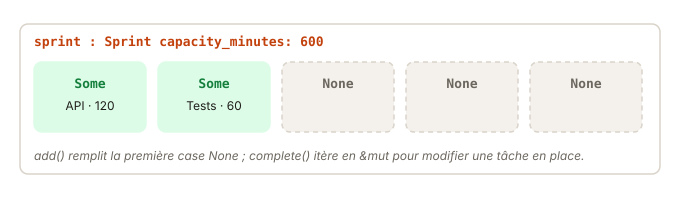

# 07 - Capstone : un sprint · cours

Te voilà au dernier exercice du module ! Tu vas écrire une petite struct métier complète, un sprint qui peut contenir jusqu'à cinq tâches. Il mobilise tout ce que tu as vu, des moves aux méthodes, et n'ajoute qu'un seul nouvel outil, `Option`, pour représenter une case vide. La leçon te présente cet outil, puis montre comment parcourir un tableau pour le lire ou le modifier. Compte une vingtaine de minutes.

## Ce que tu vas apprendre

- Représenter une case vide avec `Option<T>` plutôt qu'avec `null`.
- Lire une `Option` avec `match` et `if let`.
- Parcourir un tableau en lecture avec `&`, et en écriture avec `&mut`.
- Calculer un pourcentage entier sans perdre la précision.

## Le sprint en une phrase

Le sprint a une capacité en minutes et cinq cases, stockées dans un tableau de taille fixe, `[Option<Task>; 5]`. Chaque case contient soit une tâche, soit rien. La struct `Task` est déjà écrite pour toi, c'est celle de l'exercice précédent.



## `Option` : la case peut être vide

En TS, une case vide serait `Task | null`, et rien ne t'empêcherait d'écrire `slot.title` sur un `null`. En Rust, il n'y a pas de `null`. À la place, une case vide est une `Option<Task>`, qui vaut :

- `Some(task)` : il y a une tâche dedans ;
- `None` : la case est vide.

Tu as déjà croisé `Option` dans la leçon sur les slices, avec `find` et `split_once`. C'est la même idée. Pour atteindre la tâche, tu dois d'abord vérifier qu'elle est là. Le compilateur ne te laisse pas l'oublier.

```rust
let maybe: Option<u32> = None;
let value = match maybe {
    Some(x) => x,
    None => 0,
};
```

Quand seul le cas `Some` t'intéresse, `if let` est plus court :

```rust
if let Some(x) = maybe {
    // on ne passe ici que si maybe contient une valeur
}
```

`Option` a aussi de petites méthodes pratiques. `is_some()` et `is_none()` répondent à « y a-t-il quelque chose ? ».

## Parcourir pour lire avec `&`

Pour l'exemple, prenons une étagère de livres, avec des cases qui peuvent être vides :

```rust
pub struct Book { pub title: String, pub pages: u32, pub read: bool }
pub struct Shelf { pub slots: [Option<Book>; 4] }
```

Pour compter les livres lus, on parcourt les cases **en lecture**. `for slot in &self.slots` emprunte le tableau, et chaque `slot` est une `&Option<Book>` :

```rust
impl Shelf {
    pub fn count_read(&self) -> usize {
        let mut n = 0;
        for slot in &self.slots {
            if let Some(book) = slot {
                if book.read {
                    n += 1;
                }
            }
        }
        n
    }
}
```

Le `&` devant `self.slots` est important. Sans lui, `for` essaierait de **déplacer** les livres hors du tableau, ce que `&self` n'autorise pas. Comme `slot` est une référence, `book` en est une aussi, un `&Book`. On lit, on ne prend rien.

## Parcourir pour modifier avec `&mut`

Pour modifier les livres en place, il faut les emprunter **en écriture**. Donc `&mut self` sur la méthode, et `&mut self.slots` dans la boucle :

```rust
impl Shelf {
    pub fn mark_all_read(&mut self) {
        for slot in &mut self.slots {
            if let Some(book) = slot {
                book.read = true;
            }
        }
    }
}
```

Ici, `book` est un `&mut Book`, et tu peux changer ses champs. Si tu oublies le `mut` dans la boucle, le compilateur te le signale :

```
error[E0594]: cannot assign to `book.read`, which is behind a `&` reference
  |
  |     book.read = true;
  |     ^^^^^^^^^^^^^^^^ `book` is a `&` reference, so it cannot be written to
```

Tu peux aussi écrire `self.slots.iter()` et `self.slots.iter_mut()`, c'est la même chose. La deuxième forme se lit bien quand on enchaîne d'autres méthodes.

## Remplir une case vide

Pour ranger une valeur dans une case, tu affectes une nouvelle `Option` à la case, avec `self.slots[i] = Some(book)`. Et pour trouver la première case libre, tu combines un parcours et `is_none()`. `enumerate()` te donne l'index en plus de la case :

```rust
for (i, slot) in self.slots.iter().enumerate() {
    if slot.is_none() {
        // la case i est libre
    }
}
```

Une fonction peut sortir de la boucle dès qu'elle a trouvé, avec `return`. C'est l'usage normal de `return` en Rust, sortir tôt.

Garde un point d'ownership en tête. Une méthode qui prend un livre par valeur, `fn add(&mut self, book: Book)`, le reçoit **dans tous les cas**. Si elle refuse de le ranger, le livre est simplement libéré à la fin de la méthode. L'appelant ne le récupère pas.

## Un pourcentage avec des entiers

Pour calculer un pourcentage avec des `u32`, l'ordre des opérations compte, à cause de la division entière vue dans la leçon sur les types :

```rust
30 / 70 * 100     // 0 : 30 / 70 vaut 0 en entiers
30 * 100 / 70     // 42 : on multiplie d'abord, puis on divise
```

Multiplie d'abord, divise ensuite. Et pense au cas où le dénominateur vaut 0, car une division entière par zéro fait paniquer.

## Teste-toi

1. Pourquoi `for slot in self.slots` ne compile pas dans une méthode `&self` ?
2. Dans `for slot in &mut self.slots { if let Some(b) = slot { ... } }`, quel est le type de `b` ?
3. Que vaut `7 * 100 / 9` en `u32` ? Et `7 / 9 * 100` ?
4. Une méthode `fn add(&mut self, book: Book) -> bool` renvoie `false` sans ranger le livre. Qu'est devenu le livre ?

> **Réponses**
> 1. Sans `&`, la boucle essaie de déplacer les éléments hors du tableau, mais une méthode `&self` n'a qu'un emprunt en lecture : pas de permission O.
> 2. `&mut Book` : une référence mutable vers le livre dans la case.
> 3. `77`, et `0` (car `7 / 9` vaut 0 en entiers).
> 4. Il a été déplacé dans `add` à l'appel, puis libéré à la fin de la méthode.

## À retenir

- `Option<T>` remplace `T | null` : `Some(valeur)` ou `None`, impossible d'oublier le cas vide.
- `match` traite tous les cas, `if let` seulement celui qui t'intéresse.
- `for x in &tableau` pour lire, `for x in &mut tableau` pour modifier en place.
- Une valeur passée par valeur à une méthode lui appartient, même si elle la refuse.
- Pour un pourcentage entier : multiplie avant de diviser, et méfie-toi de la division par zéro.

## Pour aller plus loin

Tu as déjà tout ce qu'il faut pour l'exercice. Si tu as envie de creuser, voici quelques lectures, en anglais et complètement facultatives.

- [Rust Book 6.3 · if let](https://rust-book.cs.brown.edu/ch06-03-if-let.html) : `if let` en détail, en avance sur le module 03.
- [std · Option](https://doc.rust-lang.org/std/option/enum.Option.html) : toutes les méthodes d'`Option`.
- [std · slice::iter_mut](https://doc.rust-lang.org/std/primitive.slice.html#method.iter_mut)
